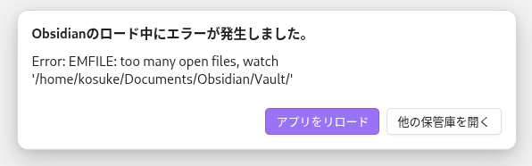

:::message
この記事は **Linux 向け**のトラブルシューティングです。`inotify` は Linux カーネルの機能のため、macOS / Windows の Obsidian で同じエラーが出た場合に、同じ原因・対処法が当てはまるかは未確認です（おそらく異なります）。
:::

## 検証環境

* OS: Ubuntu 26.04
* Arch Linux でも、`inotify` の仕組み上は同様の事象が起こり得ると考えていますが、実際には確認していません。

## 現象

Linux 環境で Obsidian を起動した際、以下のようなエラーダイアログが表示されて Vault が開けなくなりました。



```text
Obsidianのロード中にエラーが発生しました。
Error: EMFILE: too many open files, watch '/home/user/Documents/Obsidian/Vault/'
```

エラーメッセージの内容は「開いている（監視している）ファイルが多すぎる」というものですが、実際に Vault 内のファイル数を確認してみると 50 個程度しかありませんでした。

```bash
$ find ~/Documents/Obsidian/Vault/ -type f | wc -l
52
```

ファイル数が少ないにもかかわらず、なぜ `EMFILE` エラーが発生するのかを調べた結果をまとめます。

## 原因

原因は Obsidian の Vault 内のファイル数ではなく、**Linux カーネルのファイル監視機構（`inotify`）の上限にユーザー単位で達していたこと**でした。

Electron（Node.js）製のアプリケーションである Obsidian は、ファイルやディレクトリの変更検知に `inotify` を使用しています。このとき、ファイルディスクリプタの上限（`ulimit -n`）ではなく、`inotify` の以下の制限に引っかかると `EMFILE: too many open files, watch ...` というエラーになります。

* `fs.inotify.max_user_watches`: ユーザーあたりが監視できるファイル・ディレクトリ数の上限
* `fs.inotify.max_user_instances`: ユーザーあたりが作成できる `inotify` インスタンス数の上限

重要なのは、これらの上限がプロセス単位ではなく**OS のユーザー単位で共有される**という点です。

そのため、ブラウザ、VS Code などのエディタ、クラウド同期ツール、デスクトップ環境など、裏で動いている他のアプリケーションがすでに監視枠（特にデフォルト値が `128` と小さめな `max_user_instances`）を使い切っていると、Vault 自体のファイル数が少なくても Obsidian が新しく監視を開始できずにエラーとなります。

## 解決方法

### 1. 現在の制限値を確認する

ターミナルで現在の `inotify` の上限値を確認します。

```bash
$ cat /proc/sys/fs/inotify/max_user_watches
65536
$ cat /proc/sys/fs/inotify/max_user_instances
128
```

私の環境では `max_user_instances` がデフォルトの `128` になっており、ここがボトルネックになっていました。

### 2. 上限値を恒久的に引き上げる

OS を再起動しても設定が維持されるよう、`/etc/sysctl.d/` 配下に設定ファイルを作成して上限値を引き上げます。

```bash
echo "fs.inotify.max_user_watches=524288" | sudo tee /etc/sysctl.d/99-inotify.conf
echo "fs.inotify.max_user_instances=1024" | sudo tee -a /etc/sysctl.d/99-inotify.conf
```

続いて、設定を即座にシステムへ反映させます。

```bash
sudo sysctl --system
```

反映後、再度 `cat` コマンドで数値が更新されていることを確認します。

```bash
$ cat /proc/sys/fs/inotify/max_user_instances
1024
```

### 3. Obsidian をリロードする

設定変更後、Obsidian のエラーダイアログにある「アプリをリロード」をクリック（または Obsidian を再起動）すると、問題なく Vault が開けるようになります。

## 補足：上限を引き上げるリスクはあるか？

デスクトップ用途で `max_user_watches=524288`、`max_user_instances=1024` 程度に引き上げることには、リスクが全くないわけではないものの、**問題になる可能性は低い**と考えています。ただし以下は公式ドキュメント等で裏を取ったものではなく、私の理解と一般的な目安に基づく見解です。また、引き上げ後に実際に問題が起きたことは今のところありません。

* **メモリ消費量:** `inotify` の監視対象はカーネルメモリ（スワップ不可領域）を消費します。1 watch あたり 1KB 前後と言われることが多く、この目安だと上限の 524,288 個を使い切った場合は最大 500MB 前後になる計算です。ただし、**上限を上げただけではメモリは消費されず、実際に監視している分だけ消費される**と理解しています。
* **暴走プロセスの検知:** 上限は、監視を作り続けるバグのあるプロセスを早めに止める安全装置としても働きます。上限を大きくすると、そうしたプロセスが現れても気づくのが遅れ、その分メモリを消費し続ける可能性があります。デスクトップ用途ではこの影響は小さいと見ていますが、リソースの限られた環境や、複数ユーザーが使うマシンでは慎重に決めたほうがよいでしょう。

同じエラーに遭遇した場合は、まず `max_user_instances` と `max_user_watches` の値を確認してみてください。
